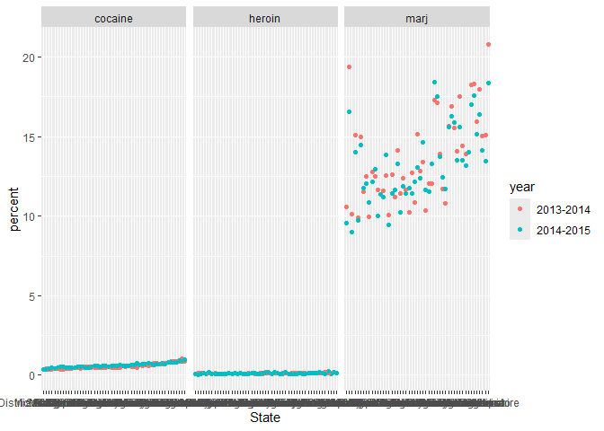

List Columns
================
2026-11-05

``` r
library(tidyverse)
```

    ## ── Attaching core tidyverse packages ──────────────────────── tidyverse 2.0.0 ──
    ## ✔ dplyr     1.2.1     ✔ readr     2.2.0
    ## ✔ forcats   1.0.1     ✔ stringr   1.6.0
    ## ✔ ggplot2   4.0.3     ✔ tibble    3.3.1
    ## ✔ lubridate 1.9.5     ✔ tidyr     1.3.2
    ## ✔ purrr     1.2.2     
    ## ── Conflicts ────────────────────────────────────────── tidyverse_conflicts() ──
    ## ✖ dplyr::filter() masks stats::filter()
    ## ✖ dplyr::lag()    masks stats::lag()
    ## ℹ Use the conflicted package (<http://conflicted.r-lib.org/>) to force all conflicts to become errors

``` r
library(rvest)
```

    ## 
    ## Attaching package: 'rvest'
    ## 
    ## The following object is masked from 'package:readr':
    ## 
    ##     guess_encoding

``` r
library(p8105.datasets)

source("source/mean_and_sd.R")
source("source/nsduh_process.R")

set.seed(127)
```

## lists

``` r
l = list(
  vec_numeric = 5:8,
  mat         = matrix(1:8, 2, 4),
  vec_logical = c(TRUE, FALSE),
  summary     = summary(rnorm(1000)))
l
```

    ## $vec_numeric
    ## [1] 5 6 7 8
    ## 
    ## $mat
    ##      [,1] [,2] [,3] [,4]
    ## [1,]    1    3    5    7
    ## [2,]    2    4    6    8
    ## 
    ## $vec_logical
    ## [1]  TRUE FALSE
    ## 
    ## $summary
    ##     Min.  1st Qu.   Median     Mean  3rd Qu.     Max. 
    ## -2.93578 -0.67747 -0.02370 -0.01393  0.66968  3.00090

## `for` loops

``` r
list_norm = list(
  a = rnorm(20, 3, 4),
  b = rnorm(20, -14, 20),
  c = rnorm(20, 1000, 1000),
  d = rnorm(20, 0, 1)
)
```

### can i get mean and sd for each sample

``` r
mean_and_sd(list_norm[[1]])
```

    ## # A tibble: 1 × 2
    ##    mean    sd
    ##   <dbl> <dbl>
    ## 1  2.71  4.46

``` r
mean_and_sd(list_norm[[2]])
```

    ## # A tibble: 1 × 2
    ##    mean    sd
    ##   <dbl> <dbl>
    ## 1 -16.9  20.9

``` r
mean_and_sd(list_norm[[3]])
```

    ## # A tibble: 1 × 2
    ##    mean    sd
    ##   <dbl> <dbl>
    ## 1  778. 1110.

``` r
mean_and_sd(list_norm[[4]])
```

    ## # A tibble: 1 × 2
    ##      mean    sd
    ##     <dbl> <dbl>
    ## 1 -0.0749 0.842

### can i do better?…yes

``` r
output = vector("list", length = 4)

for (i in 1:4){
  output[[i]] = mean_and_sd(list_norm[[i]])
}

output
```

    ## [[1]]
    ## # A tibble: 1 × 2
    ##    mean    sd
    ##   <dbl> <dbl>
    ## 1  2.71  4.46
    ## 
    ## [[2]]
    ## # A tibble: 1 × 2
    ##    mean    sd
    ##   <dbl> <dbl>
    ## 1 -16.9  20.9
    ## 
    ## [[3]]
    ## # A tibble: 1 × 2
    ##    mean    sd
    ##   <dbl> <dbl>
    ## 1  778. 1110.
    ## 
    ## [[4]]
    ## # A tibble: 1 × 2
    ##      mean    sd
    ##     <dbl> <dbl>
    ## 1 -0.0749 0.842

## `map` instead

### this is better!

``` r
output = map(list_norm, mean_and_sd)

output = map(list_norm, IQR)

output = map(list_norm, median)
```

### what about map variants

``` r
output = map_df(list_norm, mean_and_sd)
output = map_dbl(list_norm, median)
```

- `map_df` brings all the data in…list of dataframes
- `map_dbl` applies a function that is written (ex. median)

## list columns

``` r
listcol_df =
  tibble(
    name = c("a","b","c","d"),
    samp = list_norm
  )
```

### do stuff with this

``` r
listcol_df |> 
  filter(name %in% c("a", "c", "d"))
```

    ## # A tibble: 3 × 2
    ##   name  samp        
    ##   <chr> <named list>
    ## 1 a     <dbl [20]>  
    ## 2 c     <dbl [20]>  
    ## 3 d     <dbl [20]>

``` r
listcol_df |> 
  pull(samp)
```

    ## $a
    ##  [1]  0.49794171  0.03510022 11.86349866  6.98921881  7.77702270  0.17018141
    ##  [7]  3.72683987  1.01907613  2.25703873  6.15029751  3.23910968  1.78239756
    ## [13] -0.82894252  8.88523188 -2.78389030  0.64289190  7.83379417  3.56246260
    ## [19] -3.03808961 -5.58077114
    ## 
    ## $b
    ##  [1] -21.128029   2.202968   5.359215 -35.382610 -14.156111 -30.734262
    ##  [7] -52.760305 -27.273630 -49.813028 -19.991561  13.058897 -16.356994
    ## [13] -31.380476 -23.203013 -26.217260   9.698452 -35.597319  -6.178445
    ## [19]  25.656690  -2.961472
    ## 
    ## $c
    ##  [1]   261.83049  1256.54891  1473.33848 -1044.44829  -803.09027    33.85241
    ##  [7]  1375.47646    42.11859  1904.01844   299.00640   791.33792  2596.57078
    ## [13]   266.56363 -1195.85970  2519.33964   283.18236  1024.74492   597.83255
    ## [19]  1677.03107  2204.24121
    ## 
    ## $d
    ##  [1] -0.08719072  1.13493055 -0.45368603 -0.19679847  0.10147687 -0.54607660
    ##  [7] -0.35143941 -0.67495087 -0.52368252 -1.11732225  1.71088104 -0.93517801
    ## [13]  0.36230905  1.27063006  0.04060574  0.95554327  0.65021959 -0.72317447
    ## [19] -1.05382457 -1.06132537

### what about mean and sd

``` r
mean_and_sd(pull(listcol_df, samp)[[1]])
```

    ## # A tibble: 1 × 2
    ##    mean    sd
    ##   <dbl> <dbl>
    ## 1  2.71  4.46

### could i iterate?

``` r
map(pull(listcol_df, samp), mean_and_sd)
```

    ## $a
    ## # A tibble: 1 × 2
    ##    mean    sd
    ##   <dbl> <dbl>
    ## 1  2.71  4.46
    ## 
    ## $b
    ## # A tibble: 1 × 2
    ##    mean    sd
    ##   <dbl> <dbl>
    ## 1 -16.9  20.9
    ## 
    ## $c
    ## # A tibble: 1 × 2
    ##    mean    sd
    ##   <dbl> <dbl>
    ## 1  778. 1110.
    ## 
    ## $d
    ## # A tibble: 1 × 2
    ##      mean    sd
    ##     <dbl> <dbl>
    ## 1 -0.0749 0.842

``` r
listcol_df |> 
  mutate(
    output = map(samp, mean_and_sd)
  )
```

    ## # A tibble: 4 × 3
    ##   name  samp         output          
    ##   <chr> <named list> <named list>    
    ## 1 a     <dbl [20]>   <tibble [1 × 2]>
    ## 2 b     <dbl [20]>   <tibble [1 × 2]>
    ## 3 c     <dbl [20]>   <tibble [1 × 2]>
    ## 4 d     <dbl [20]>   <tibble [1 × 2]>

``` r
listcol_df |> 
  mutate(
    output = map_df(samp, mean_and_sd)
  )
```

    ## # A tibble: 4 × 3
    ##   name  samp         output$mean      $sd
    ##   <chr> <named list>       <dbl>    <dbl>
    ## 1 a     <dbl [20]>        2.71      4.46 
    ## 2 b     <dbl [20]>      -16.9      20.9  
    ## 3 c     <dbl [20]>      778.     1110.   
    ## 4 d     <dbl [20]>       -0.0749    0.842

``` r
listcol_df |> 
  mutate(
    output = map_df(samp, median)
  )
```

    ## # A tibble: 4 × 3
    ##   name  samp         output$a    $b    $c     $d
    ##   <chr> <named list>    <dbl> <dbl> <dbl>  <dbl>
    ## 1 a     <dbl [20]>       2.02 -20.6  695. -0.274
    ## 2 b     <dbl [20]>       2.02 -20.6  695. -0.274
    ## 3 c     <dbl [20]>       2.02 -20.6  695. -0.274
    ## 4 d     <dbl [20]>       2.02 -20.6  695. -0.274

## another example

``` r
nsduh_url = "https://www.samhsa.gov/data/sites/default/files/NSDUHsaeShortTermCHG2015/NSDUHsaeShortTermCHG2015.htm"

nsduh_html = read_html(nsduh_url)

nsduh_process(html = nsduh_html, table_num = 1)
```

    ## # A tibble: 510 × 4
    ##    State   age   year      percent
    ##    <chr>   <chr> <chr>       <dbl>
    ##  1 Alabama 12+   2013-2014    9.98
    ##  2 Alabama 12+   2014-2015    9.6 
    ##  3 Alabama 12-17 2013-2014    9.9 
    ##  4 Alabama 12-17 2014-2015    9.71
    ##  5 Alabama 18-25 2013-2014   27.0 
    ##  6 Alabama 18-25 2014-2015   26.1 
    ##  7 Alabama 26+   2013-2014    7.1 
    ##  8 Alabama 26+   2014-2015    6.81
    ##  9 Alabama 18+   2013-2014    9.99
    ## 10 Alabama 18+   2014-2015    9.59
    ## # ℹ 500 more rows

``` r
nsduh_process(html = nsduh_html, table_num = 4)
```

    ## # A tibble: 510 × 4
    ##    State   age   year      percent
    ##    <chr>   <chr> <chr>       <dbl>
    ##  1 Alabama 12+   2013-2014    1.23
    ##  2 Alabama 12+   2014-2015    1.22
    ##  3 Alabama 12-17 2013-2014    0.42
    ##  4 Alabama 12-17 2014-2015    0.41
    ##  5 Alabama 18-25 2013-2014    3.09
    ##  6 Alabama 18-25 2014-2015    3.2 
    ##  7 Alabama 26+   2013-2014    1.01
    ##  8 Alabama 26+   2014-2015    0.99
    ##  9 Alabama 18+   2013-2014    1.31
    ## 10 Alabama 18+   2014-2015    1.31
    ## # ℹ 500 more rows

``` r
nsduh_process(html = nsduh_html, table_num = 5)
```

    ## # A tibble: 510 × 4
    ##    State   age   year      percent
    ##    <chr>   <chr> <chr>       <dbl>
    ##  1 Alabama 12+   2013-2014    0.22
    ##  2 Alabama 12+   2014-2015    0.27
    ##  3 Alabama 12-17 2013-2014    0.1 
    ##  4 Alabama 12-17 2014-2015    0.08
    ##  5 Alabama 18-25 2013-2014    0.45
    ##  6 Alabama 18-25 2014-2015    0.64
    ##  7 Alabama 26+   2013-2014    0.19
    ##  8 Alabama 26+   2014-2015    0.23
    ##  9 Alabama 18+   2013-2014    0.23
    ## 10 Alabama 18+   2014-2015    0.29
    ## # ℹ 500 more rows

### import using iteration

``` r
output = vector("list", length = 3)

table_nums = c(1, 4, 5)

for (i in 1:3) {
  output[[i]] = nsduh_process(html = nsduh_html, table_num = table_nums[i])
}

output
```

    ## [[1]]
    ## # A tibble: 510 × 4
    ##    State   age   year      percent
    ##    <chr>   <chr> <chr>       <dbl>
    ##  1 Alabama 12+   2013-2014    9.98
    ##  2 Alabama 12+   2014-2015    9.6 
    ##  3 Alabama 12-17 2013-2014    9.9 
    ##  4 Alabama 12-17 2014-2015    9.71
    ##  5 Alabama 18-25 2013-2014   27.0 
    ##  6 Alabama 18-25 2014-2015   26.1 
    ##  7 Alabama 26+   2013-2014    7.1 
    ##  8 Alabama 26+   2014-2015    6.81
    ##  9 Alabama 18+   2013-2014    9.99
    ## 10 Alabama 18+   2014-2015    9.59
    ## # ℹ 500 more rows
    ## 
    ## [[2]]
    ## # A tibble: 510 × 4
    ##    State   age   year      percent
    ##    <chr>   <chr> <chr>       <dbl>
    ##  1 Alabama 12+   2013-2014    1.23
    ##  2 Alabama 12+   2014-2015    1.22
    ##  3 Alabama 12-17 2013-2014    0.42
    ##  4 Alabama 12-17 2014-2015    0.41
    ##  5 Alabama 18-25 2013-2014    3.09
    ##  6 Alabama 18-25 2014-2015    3.2 
    ##  7 Alabama 26+   2013-2014    1.01
    ##  8 Alabama 26+   2014-2015    0.99
    ##  9 Alabama 18+   2013-2014    1.31
    ## 10 Alabama 18+   2014-2015    1.31
    ## # ℹ 500 more rows
    ## 
    ## [[3]]
    ## # A tibble: 510 × 4
    ##    State   age   year      percent
    ##    <chr>   <chr> <chr>       <dbl>
    ##  1 Alabama 12+   2013-2014    0.22
    ##  2 Alabama 12+   2014-2015    0.27
    ##  3 Alabama 12-17 2013-2014    0.1 
    ##  4 Alabama 12-17 2014-2015    0.08
    ##  5 Alabama 18-25 2013-2014    0.45
    ##  6 Alabama 18-25 2014-2015    0.64
    ##  7 Alabama 26+   2013-2014    0.19
    ##  8 Alabama 26+   2014-2015    0.23
    ##  9 Alabama 18+   2013-2014    0.23
    ## 10 Alabama 18+   2014-2015    0.29
    ## # ℹ 500 more rows

### let’s build a map example

``` r
output = map(table_nums, nsduh_process, html = nsduh_html)
```

### let’s try list columns

``` r
nsduh_df =
  tibble(
    drug = c("marj", "cocaine", "heroin"),
    num = c(1, 4, 5)
  ) |> 
  mutate(
    table = map(num, nsduh_process, html = nsduh_html)
  ) |> 
  select(-num) |> 
  unnest(table)

nsduh_df |> 
  filter(age == "12-17") |> 
  mutate(State = fct_reorder(State, percent)) |> 
  ggplot(aes(x = State, y = percent, color = year)) +
  geom_point() +
  facet_grid(. ~ drug)
```

<!-- -->

- creating a new factor variable “num” helps keep stuff concise
- `unnest` takes all the dataframes and expands then into one

## weather example

``` r
data("weather_df")

weather_df = 
  weather_df |> 
  nest(data = date:tmin)
```

- `nest` does the opposite: gets all the dataframes and shortens them

### what if i want to do a regression of tmax on tmin for each station?

``` r
lm(tmax ~ tmin, data = pull(weather_df, data)[[1]])
```

    ## 
    ## Call:
    ## lm(formula = tmax ~ tmin, data = pull(weather_df, data)[[1]])
    ## 
    ## Coefficients:
    ## (Intercept)         tmin  
    ##       7.514        1.034

``` r
lm(tmax ~ tmin, data = pull(weather_df, data)[[2]])
```

    ## 
    ## Call:
    ## lm(formula = tmax ~ tmin, data = pull(weather_df, data)[[2]])
    ## 
    ## Coefficients:
    ## (Intercept)         tmin  
    ##     21.7547       0.3222

``` r
lm(tmax ~ tmin, data = pull(weather_df, data)[[3]])
```

    ## 
    ## Call:
    ## lm(formula = tmax ~ tmin, data = pull(weather_df, data)[[3]])
    ## 
    ## Coefficients:
    ## (Intercept)         tmin  
    ##       7.532        1.137

``` r
weather_lm = function (input_data){
  lm(tmax ~ tmin, data = input_data)
}

weather_lm(pull(weather_df, data)[[1]])
```

    ## 
    ## Call:
    ## lm(formula = tmax ~ tmin, data = input_data)
    ## 
    ## Coefficients:
    ## (Intercept)         tmin  
    ##       7.514        1.034

``` r
weather_df |> 
  mutate(
    lm_fits = map(data, weather_lm)
  ) |> 
  pull(lm_fits)
```

    ## [[1]]
    ## 
    ## Call:
    ## lm(formula = tmax ~ tmin, data = input_data)
    ## 
    ## Coefficients:
    ## (Intercept)         tmin  
    ##       7.514        1.034  
    ## 
    ## 
    ## [[2]]
    ## 
    ## Call:
    ## lm(formula = tmax ~ tmin, data = input_data)
    ## 
    ## Coefficients:
    ## (Intercept)         tmin  
    ##     21.7547       0.3222  
    ## 
    ## 
    ## [[3]]
    ## 
    ## Call:
    ## lm(formula = tmax ~ tmin, data = input_data)
    ## 
    ## Coefficients:
    ## (Intercept)         tmin  
    ##       7.532        1.137
