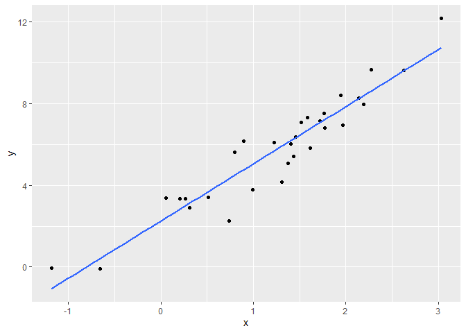
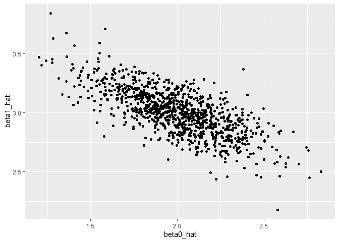
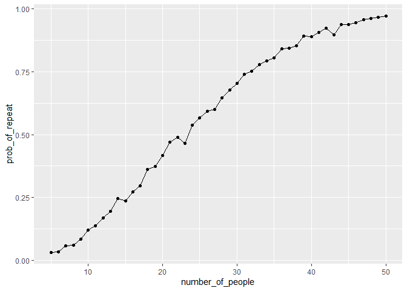

Simulation
================
2026-11-10

``` r
library(tidyverse)
```

    ## ── Attaching core tidyverse packages ──────────────────────── tidyverse 2.0.0 ──
    ## ✔ dplyr     1.2.1     ✔ readr     2.2.0
    ## ✔ forcats   1.0.1     ✔ stringr   1.6.0
    ## ✔ ggplot2   4.0.3     ✔ tibble    3.3.1
    ## ✔ lubridate 1.9.5     ✔ tidyr     1.3.2
    ## ✔ purrr     1.2.2     
    ## ── Conflicts ────────────────────────────────────────── tidyverse_conflicts() ──
    ## ✖ dplyr::filter() masks stats::filter()
    ## ✖ dplyr::lag()    masks stats::lag()
    ## ℹ Use the conflicted package (<http://conflicted.r-lib.org/>) to force all conflicts to become errors

``` r
source("source/sim_mean_sd.R")
source("source/sim_slr.R")
source("source/birthday_repeated.R")

set.seed(127)
```

## mean and SD

### let’s do this but keep track of results

``` r
output = vector("list", length = 1000)

for (i in 1:1000){
   output[[i]] = sim_mean_sd(30)
}
```

### inspect results

``` r
output |> 
  bind_rows() |> 
  summarize(
    emp_m = mean(mean),
    emp_se = sd(mean)
  )
```

    ## # A tibble: 1 × 2
    ##   emp_m emp_se
    ##   <dbl>  <dbl>
    ## 1  12.0  0.559

``` r
output |> 
  bind_rows() |> 
  ggplot(aes(x = mean)) +
  geom_density()
```

<!-- -->

### let’s do this using tibbles and map instead

``` r
sim_results_df =
  tibble(
    samp_size = rep(30, 1000)
  ) |> 
  mutate(
    est_df = map(samp_size, sim_mean_sd)
  ) |> 
  unnest(est_df)
```

### look at results

``` r
sim_results_df |> 
  ggplot(aes(x = mean)) +
  geom_density()
```

<!-- -->

## change `n`

``` r
sim_results_df =
  expand_grid(
    samp_size = c(30, 60, 120, 240),
    iter = 1:1000
  ) |> 
  mutate(
    est_df = map(samp_size, sim_mean_sd)
  ) |> 
  unnest(est_df)
```

- expand_grid: gives combination of sample size and iteration up to the
  highest number (ex. 30, 1; 30, 2; 30, 3;…30, 1000)

``` r
sim_results_df |> 
  mutate(
    samp_size = str_c("n = ", samp_size),
    samp_size = fct_inorder(samp_size)
  ) |> 
  ggplot(aes(x = samp_size, y = mean)) +
  geom_violin()
```

<!-- -->

``` r
sim_results_df |> 
  mutate(
    samp_size = str_c("n = ", samp_size),
    samp_size = fct_inorder(samp_size)
  ) |> 
  group_by(samp_size) |> 
  summarize(
    emp_m = mean(mean),
    emp_se = sd(mean)
  )
```

    ## # A tibble: 4 × 3
    ##   samp_size emp_m emp_se
    ##   <fct>     <dbl>  <dbl>
    ## 1 n = 30     12.0  0.544
    ## 2 n = 60     12.0  0.389
    ## 3 n = 120    12.0  0.263
    ## 4 n = 240    12.0  0.191

## SLR

### generate once

``` r
sim_data =
  tibble(
    x = rnorm(30, mean = 1, sd = 1),
    y = 2 + 3*x + rnorm(30, mean = 0, sd = 1)
  )

sim_data |> 
  ggplot(aes(x = x, y = y)) +
  geom_point() +
  geom_smooth(method = "lm", se = FALSE)
```

    ## `geom_smooth()` using formula = 'y ~ x'

<!-- -->

``` r
fit = lm(y ~ x, data = sim_data)
```

### turn this into a function

(did that, it’s in `source/sim_slr.R`)

``` r
sim_slr(30)
```

    ## # A tibble: 1 × 2
    ##   beta0_hat beta1_hat
    ##       <dbl>     <dbl>
    ## 1      2.15      2.93

### do this a lot

``` r
slr_results_df = 
  tibble(
    samp_size = rep(30, 1000)
  ) |> 
  mutate(
    est_df = map(samp_size, sim_slr)
  ) |> 
  unnest(est_df)
```

### is this right?

``` r
slr_results_df |> 
  summarize(
    b0_mean = mean(beta0_hat),
    b0_se = sd(beta0_hat)
  )
```

    ## # A tibble: 1 × 2
    ##   b0_mean b0_se
    ##     <dbl> <dbl>
    ## 1    2.00 0.265

### look at the results

``` r
slr_results_df |> 
  ggplot(aes(x = beta0_hat, y = beta1_hat)) +
  geom_point()
```

<!-- -->

## birthday problem

``` r
birthdays = sample(1:365, size = 5, replace = TRUE)

repeated_birthdays = length(unique(birthdays)) < 5

repeated_birthdays
```

    ## [1] FALSE

### turn into function

(i did)…run it a bunch

``` r
birthday_repeated(147)
```

    ## [1] TRUE

run it a bunch but good

``` r
birthday_results_df = 
  expand_grid(
    number_of_people = 5:50,
    iter = 1:1000
  ) |> 
  mutate(
    repeated = map_lgl(number_of_people, birthday_repeated)
  )
```

- map_lgl: turns numbers into TRUE/FALSE (logical vector)

### look at results

``` r
birthday_results_df |> 
  group_by(number_of_people) |> 
  summarize(prob_of_repeat = mean(repeated)) |> 
  ggplot(aes(x = number_of_people, y = prob_of_repeat)) +
  geom_point() + 
  geom_line()
```

<!-- -->
